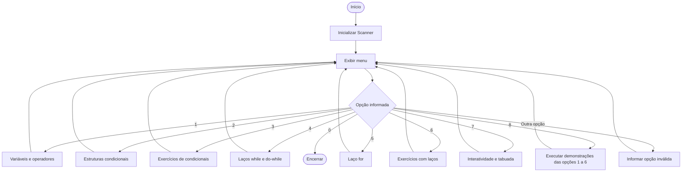

# Curso de Lógica e Programação em Java

## Conceito

Este projeto é um programa de console desenvolvido em Java para apresentar conceitos fundamentais de lógica de programação por meio de exemplos práticos. O usuário escolhe os conteúdos em um menu interativo; o programa demonstra variáveis, operadores, decisões, repetições e entrada e saída de dados.

A parte de interatividade também relaciona, em nível conceitual, a leitura e a exibição de informações no console Java com ações comuns em páginas web que usam JavaScript e o DOM.

## Árvore do curso

```text
Curso de Lógica e Programação
├── 1. Introdução, variáveis e operadores
│   ├── Tipos de dados: String, int, double e boolean
│   └── Operações aritméticas
├── 2. Estruturas condicionais
│   └── if, else if, else e operadores lógicos e relacionais
├── 3. Exercícios de condicionais
│   ├── Par ou ímpar
│   ├── Faixa etária
│   └── Situação do voto
├── 4. Laços while e do-while
├── 5. Laço for
│   ├── Contagem progressiva e regressiva
│   └── Contagem com incremento
├── 6. Exercícios com laços
│   ├── Tabuada
│   ├── Soma acumulada
│   └── Contagem de números pares
└── 7. Interatividade
    ├── Leitura de dados com Scanner
    └── Exibição de uma tabuada informada pelo usuário
```

## Fluxograma



## Como executar

É necessário ter o Java instalado. A partir da pasta que contém `CursoLogica.java`, execute:

```bash
java CursoLogica.java
```

Como alternativa, compile e execute em dois passos:

```bash
javac CursoLogica.java
java CursoLogica
```

## Arquivo principal

- `CursoLogica.java` — contém o menu e os exemplos do curso.
